# Hey there! I'm Antonio 🍕 🇮🇹 🧑‍💻

## Tech Stack

## Contributions

<picture>
  <source media="(prefers-color-scheme: dark)" srcset="https://raw.githubusercontent.com/antoniooodev/antoniooodev/master/assets/contributions/dark.svg" />
  
</picture>

## Connect with Me

  
  
  
  

 

## Blackjack

Get as close to 21 as you can without going over. Pick a move: it opens an issue, a GitHub Action plays it and updates this page within a minute.

<!-- blackjack-area -->

<b>Dealer</b>&nbsp;&nbsp;·&nbsp;&nbsp;10 + ?

&nbsp;

<h3 align="center">Player's turn · Hit or Stand?</h3>

&nbsp;

<b>Player</b>&nbsp;&nbsp;·&nbsp;&nbsp;16

  
  
  

Game history

- **New Game** by [antoniooodev](https://github.com/antoniooodev)

<!-- /blackjack-area -->
